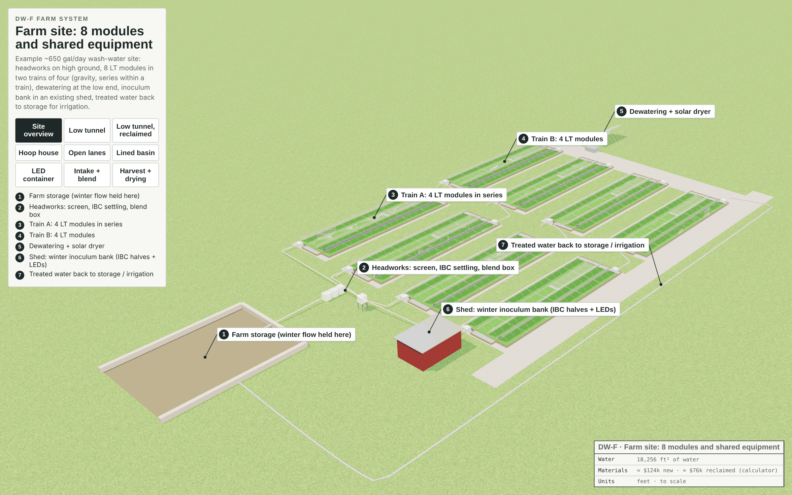
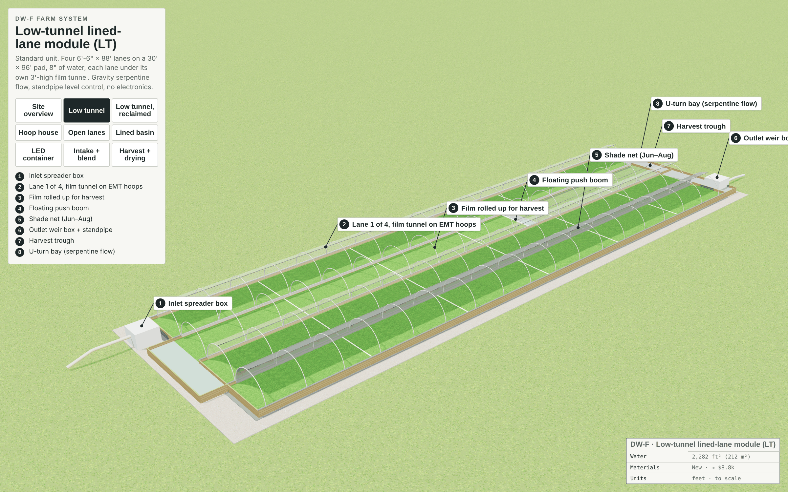
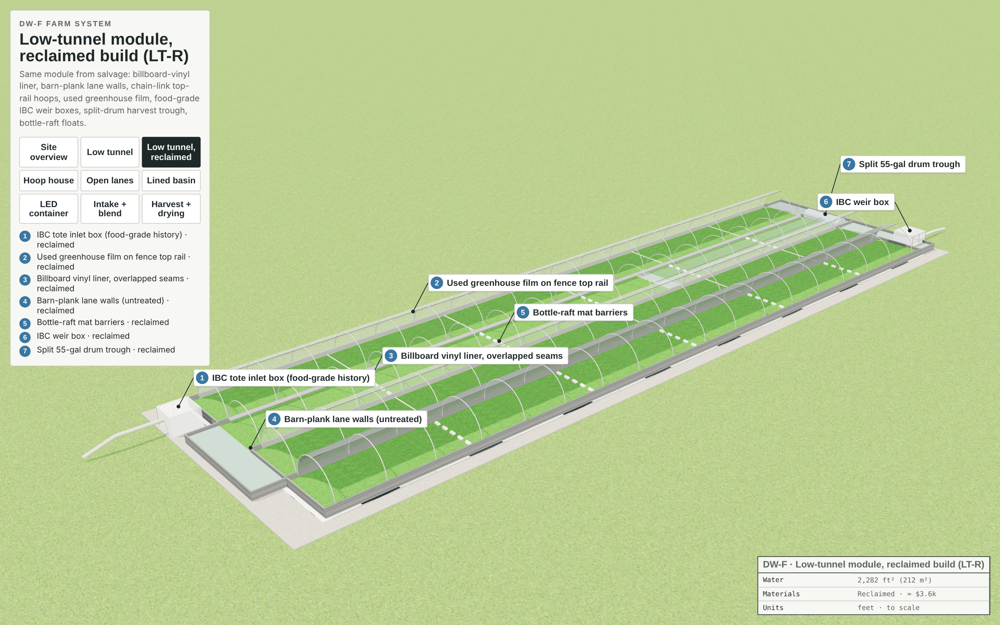
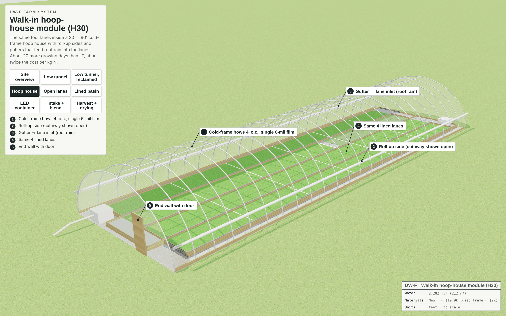
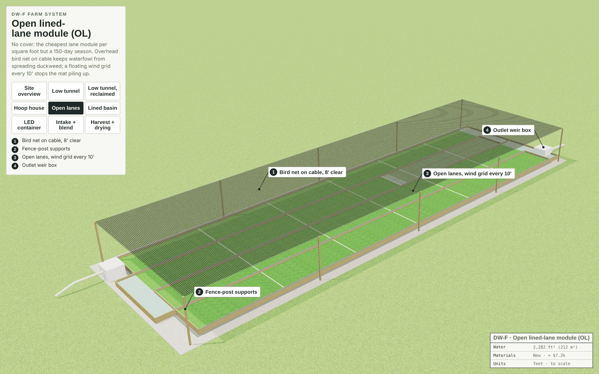
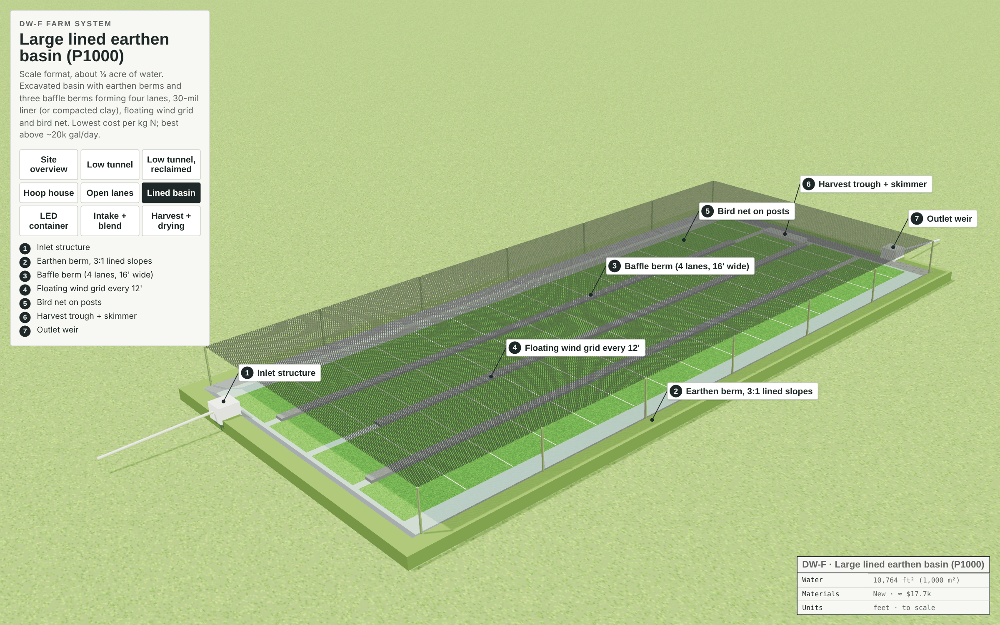
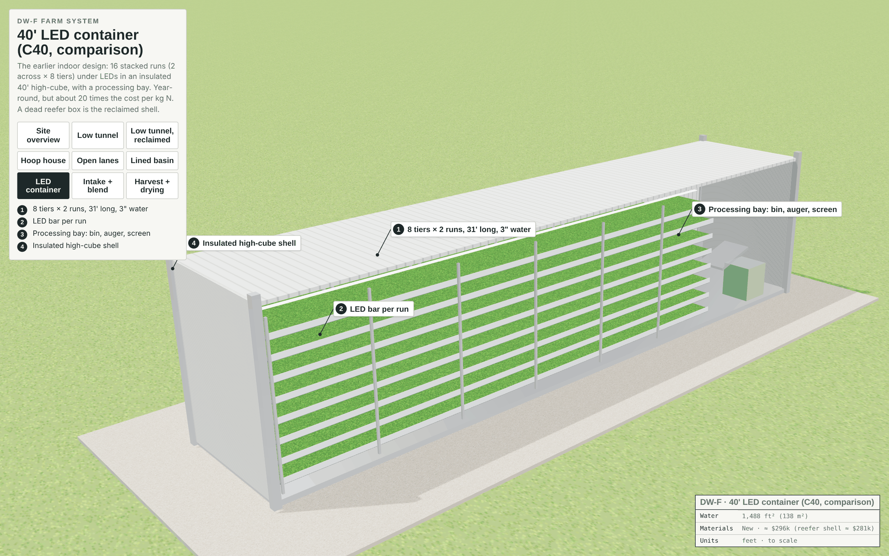
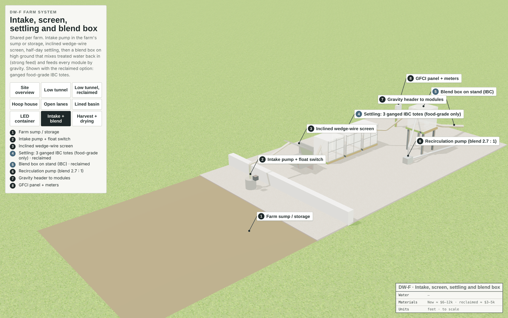
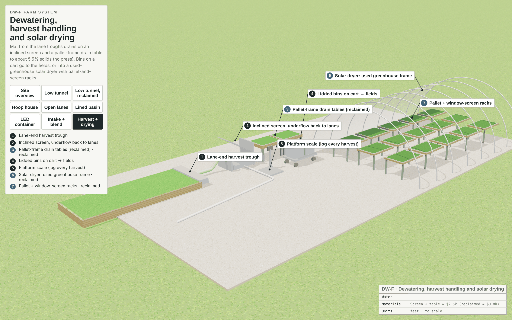

# DW-F: Standalone Farm Duckweed System (low-cost, modular)

A duckweed treatment and biomass system for a single farm, built from one repeatable, low-cost unit and sized by a simple rule from the farm's wastewater. It uses sunlight instead of LEDs, gravity flow instead of pumps, and farm-built lined lanes instead of containers. The container and trailer designs elsewhere in this repo stay as the year-round, R&D or seed-bank option.

- Interactive sizer: [`farm-sizing-tool.html`](farm-sizing-tool.html) (open in a browser; enter gal/day and stream strength)
- Calculator: [`farm_sizing.py`](farm_sizing.py) (every number below comes from it; `python3 farm-system/farm_sizing.py`)
- Renderings of every module type: [`renders/`](renders/) (PNGs) and the interactive 3D viewer [`module-renders.html`](module-renders.html)
- `build_tool.py` regenerates the HTML tool from `tool_template.html` with the catalog and constants from `farm_sizing.py`, so both always use the same numbers.

All costs are 2026 USD planning estimates (roughly ±30%, ±40% for earthwork), not quotes. Growth rates are literature-based and must be confirmed on the farm's own water.

---

## 1. Result in one paragraph

**The nitrogen load sets the size, not the flow.** Each square metre of duckweed takes up about 0.36 g N/day in season (6.5 g dry weight × 5.5% N). A farm's wash water at 120 mg/L TN therefore needs about 2,300 m² (25,000 ft²) of water surface per 1,000 gal/day of yearly flow when winter flow is stored and treated in season. The cheapest enclosed unit is a **low-tunnel lined-lane module (LT)** at about **$8,800 in materials for 2,280 ft² of water ($3.90/ft²)**, roughly 70 times cheaper per square foot than the 40' container. At scale, an **earthen lined basin (P1000)** is cheapest of all at about $1.65/ft². All-in cost (operating plus capital over 15 years) comes to about **$80 to $150 per kg N removed, or $35 to $85 per 1,000 gal**, against $3,200/kg N for LED containers. Sold as dried fertilizer, the biomass covers roughly a third to half of that cost. The rest has to come from avoided hauling, nutrient credits or a treatment fee, so the business case still depends on the host farm's situation.

**Built from reclaimed materials** (billboard vinyl liner, used greenhouse film, fence top-rail hoops, food-grade IBC totes and drums, barn lumber, used irrigation pipe), an LT module drops to about **$3,600 in materials ($1.55/ft²)** and the all-in cost falls by about a quarter, to **$100–140 per kg N** for LT modules and **$58–92 per kg N** for basins (§2.5).

---

## 2. The unit module

### 2.1 LT: low-tunnel lined-lane module (recommended standard unit)

| | |
|---|---|
| Pad | 30' × 96', graded flat to ±½", 2" sand bed. Built with farm equipment |
| Lanes | 4 lanes, each about 6'-6" × 88', formed by PT 2×12 boards on edge, staked. One 20-mil reinforced PE liner over 8-oz geotextile is draped over the whole pad and up the lane walls |
| Water | 8" (20 cm) deep, 3" freeboard. 2,282 ft² (212 m²) of water, about 11,000 gal |
| Flow | Serpentine: lane 1 → U-turn → lane 2 → … → lane 4, about 350 ft of plug flow. Inlet spreader at lane 1, adjustable standpipe weir box at lane 4 sets the level with no electronics |
| Cover | Each lane under its own 3'-high low tunnel: ½" EMT hoops bent from 10' sticks at 5' spacing, bolted to the lane walls, 6-mil UV film with ridge rope and clips. Film swaps for 30% shade / insect net June to August. Duckweed is an inch tall, so a walk-in greenhouse is not needed |
| Mat control | Sealed 1½" PVC floating barriers across each lane every ~15' keep the mat evenly spread |
| Harvest | Every 3 days. A rope-drawn floating push boom moves the mat down the lane to a trough at the lane end; leave about a third of the mat as seed |
| Interconnect | 4" PVC from the weir box to the next module's inlet. Modules run in series (one train) or in parallel trains off one header |
| Season | ~190 growing days (mid-April to late October in Wisconsin); drained or left to freeze in winter |
| Materials | **$8,817** per module (itemized in the tool and below), +10% install labor |

**Module bill of materials (LT)**

| Item | Qty | Cost |
|---|---|---|
| Grade pad, 2" sand bed (farm equipment) | 1 lot | $1,200 |
| Lane walls: PT 2×12 on edge + stakes | 560 lf | $1,456 |
| Geotextile underlay, 8 oz non-woven | 3,300 ft² | $495 |
| Pond liner, 20-mil reinforced PE, one piece 34' × 100' | 3,400 ft² | $1,496 |
| Low-tunnel hoops, ½" EMT, 5' o.c. | 80 | $560 |
| Tunnel film, 6-mil UV poly 14' × 100' | 4 | $560 |
| Ridge rope, tie-downs, clips, end ties | 4 sets | $600 |
| Shade / insect net 30% (summer) | 4 | $600 |
| Inlet spreader + adjustable standpipe weir box | 1 set | $450 |
| 4" PVC interconnect + fittings | 1 lot | $350 |
| Floating mat barriers | 1 lot | $250 |
| Harvest trough, rope-drawn push boom, hand skimmer | 1 set | $500 |
| Fasteners, sealant, labels | 1 lot | $300 |
| **Total** | | **$8,817** |

### 2.2 Other module types in the calculator

| Code | Module | Water per unit | Materials per unit | Season | Use it when |
|---|---|---|---|---|---|
| **LT** | Low-tunnel lined lanes | 2,282 ft² | $8.8k ($3.90/ft²) | 190 d | Standard unit. Covered (containment, no birds, rain or leaves), harvestable by one person, portable |
| H30 | Same lanes inside a 30' × 96' walk-in hoop house, gutters feed roof rain to the lanes | 2,282 ft² | $19.9k ($8.70/ft²) | 210 d | Longer season and comfortable winter-edge work; costs about twice LT per kg N |
| OL | Same lanes, open, overhead bird net | 2,282 ft² | $7.2k ($3.20/ft²) | 150 d | About the same cost per kg N as LT but shorter season and more contamination risk |
| P1000 | ~1,000 m² (¼ acre) earthen basin, 4 baffled lanes, 30-mil liner, bird net | 10,764 ft² | $17.7k ($1.65/ft²) | 150 d | Lowest cost per kg N at any size; needs suitable soils, an excavator and harvesting across 5 m-wide lanes. Best above ~20k gal/day |
| C40 | 40' LED container (existing design) | 1,488 ft² | $296k | 350 d | Year-round R&D, seed bank, winter capacity. Not a cost-effective farm treatment unit |

### 2.3 Shared site equipment (one set per farm, scaled by flow)

Intake pump with float switch in the farm's sump or storage → inclined wedge-wire or bag screen (0.5–1 mm) → half-day settling tank (poly tank, or a lined basin above 10,000 gal) → **blend box** with float valve on high ground → gravity to all modules. The only pumps are the intake and, for strong feed, a low-head recirculation pump that blends treated water back into the feed so module inlets stay under 40 mg/L TN (free-ammonia limit). For 120 mg/L wash water the blend is about 2.7 : 1.

Also: inclined-screen dewatering tables (one per 500 kg fresh/day), harvest cart and bins with a platform scale, field meters (pH, EC, DO, temperature, NH₄/NO₃/PO₄ photometer, level alarms), one 240 V circuit, and a **winter inoculum bank** (two IBC half-totes under LED shop lights indoors, about $1,500) so the strain survives winter without a container.

### 2.4 Biomass

Default route: drained biomass (~5.5% solids, no press, because press juice takes N back into the water) goes straight onto the farm's fields as an organic N-P-K amendment. Optional route: solar drying on mesh tables in a 30' × 96' hoop (one per ~300 kg water evaporated per day, $15k each) to a ~5-2-3 meal sold at about $2.50/kg wholesale.

---

### 2.5 Reclaimed build (recycle wherever it is safe)

Every module and site line has a reclaimed alternative in the calculator (`--materials reclaimed`, or the **Materials** toggle in the tool). The reclaimed price includes typical purchase and haul. On top of that the model adds 15% install labor for collecting, cleaning, sorting and seaming. It also raises upkeep from 3% to 5% of equipment cost a year (shorter life) and takes 5% off growth under aged film. Field meters, electrical and grading stay new: there is no saving there, or accuracy and safety matter more.

**LT module, reclaimed**

| New item | Reclaimed alternative | Cost | Where to get it | Watch for |
|---|---|---|---|---|
| 20-mil RPE liner ($1,496) | Retired billboard vinyl, ~6 sheets 14' × 48', 2' overlaps + seam tape | $224 | Billboard / sign companies, often free to $75 a sheet | PVC with inks: fine for fertilizer, **not for feed or food**; check for holes; 3–5 yr life |
| Geotextile ($495) | Old carpet, worn hay/silage tarps, or 2" more sand | $99 | Carpet installers, the farm | Pull staples and nails; under the liner only |
| PT 2×12 lane walls ($1,456) | Barn planks / reclaimed 2×12, or doubled pallet deck boards | $582 | Barn tear-downs, pallet yards | Never CCA, creosote or methyl-bromide ("MB") pallets; HT-stamped only; untreated wood lasts 3–6 seasons |
| EMT hoops ($560) | Chain-link fence top rail (1-3/8"), bent | $168 | Fence contractors' tear-outs | Rust at joints |
| Tunnel film ($560) | Used greenhouse film from re-skins | $56 | Commercial greenhouses re-skin every ~4 yr | 10–15% less light; 1–2 seasons |
| Ridge rope, ties ($600) | Baler twine, reclaimed rope, scrap rebar stakes | $180 | The farm | UV-brittle twine, replace yearly |
| Shade net ($600) | Used shade cloth / orchard netting | $180 | Nurseries, orchards | Patch holes |
| Inlet + weir boxes ($450) | Cut-down IBC totes + reclaimed PVC standpipe | $180 | IBC resellers, $50–100 | **Food-grade history only** (syrup, juice, oil); never chemical or pesticide totes |
| 4" PVC interconnect ($350) | Used irrigation pipe or drain tile | $140 | Farm auctions | Gravity only; check joints |
| Floating barriers ($250) | Capped scrap PVC or sealed 2-L bottles on rope | $50 | Recycling | Brittle in UV |
| Harvest trough, boom ($500) | Split 55-gal food-grade drums, PVC + pool-noodle boom | $200 | Food plants, car washes | Food-grade drums; deburr edges |
| Grading, fasteners | Unchanged | $1,500 | | |
| **Total** | | **$3,560** (vs $8,817 new) | | |

**Other reclaimed swaps**

| Where | Reclaimed option | Saving | Watch for |
|---|---|---|---|
| H30 hoop house | Used greenhouse frame bought at a dismantle; reused lock channel; end walls from barn lumber and old storm doors; salvaged gutters | Frame ~60% | Missing parts, kinked bows, may not meet local snow load |
| P1000 basin | **Compacted on-site clay** instead of a liner where subsoil is >20% clay (billboard vinyl patches at inlets); used orchard or fishing net; culvert offcuts for structures | Liner ~75% | Needs a percolation test and possibly DNR sign-off; seepage on sandy sites |
| C40 container | Dead reefer container or reefer trailer shell (already insulated) | ~$15k | Floor and door seals |
| Intake | Rebuilt effluent pump from a farm dispersal | ~50% | Keep a spare; the intake is a single point of failure |
| Screen | Food-plant surplus stainless wedge-wire, or stainless window screen on a sloped pallet frame | ~60% | Window screen clogs faster |
| Settling | Ganged used IBC totes, or a **retired bulk milk tank** (stainless, has a drain) | ~65% | Food-grade history only |
| Blend box | IBC tote on a pallet stand | ~70% | |
| Dewatering | Pallet-frame drain table with stainless window screen, or surplus vibrating screen from a dairy plant | ~70% | Food-contact screen if biomass may go to feed |
| Solar dryer | Used greenhouse frame, pallet-and-window-screen racks | ~65% | |

**Rules for reclaimed material.** (1) Nothing that held chemicals, pesticides or medicated feed touches the water or the biomass. (2) No CCA, creosote or "MB" wood anywhere. (3) Recycled plastics and billboard vinyl suit the fertilizer route; if the biomass may become feed, line with new NSF/food-grade material and keep reclaimed items to non-contact uses. (4) Test the first harvests for metals and phthalates when vinyl liners are used.

## 3. Sizing rule

```
season inflow     Q_s = Q × 365 / growing days        (store winter flow, treat in season)
                      = Q                             (treat in season only; the rest goes where it goes today)
N to remove       = Q_s × TN_in − Q_effluent × TN_out (effluent shrinks by evaporation)
water area        = N to remove ÷ (g DW/m²/d × 5.5% N)
                    but not less than Q_s × 5 days ÷ depth  (minimum contact time for dilute streams)
modules           = ceil(area ÷ module water area)
blend ratio       = (TN_in − 40) ÷ (40 − TN_out)  when TN_in > 40 mg/L
harvest           = area × g ÷ 6% dry matter  kg fresh per day
```

**Evaporation matters.** In season an LT module loses about 2.5 mm/day and open water 4–4.5 mm/day. One square metre can only treat about 3 L/day of 120 mg/L water, so on strong streams evaporation takes most of the inflow. Above roughly 140 mg/L TN (LT) the system approaches zero discharge and needs make-up water (roof rain, well) to bleed salts. The tool flags this.

## 4. Sizing table

Screened dairy wash water, 120 mg/L TN → 10 mg/L, TP 25 mg/L. Winter flow stored and treated in season. Design growth (6.5 g DW/m²/d).

**LT low-tunnel modules**

| Farm flow (gal/d) | Modules | Water area | Land incl. spacing | Winter storage | Blend | Effluent (gal/d, season) | N removed (kg/yr) | P removed (kg/yr) | Fresh harvest (kg/d) | Labor (h/yr) | Build cost | Opex/yr | All-in $/kg N | All-in $/1,000 gal |
|---|---|---|---|---|---|---|---|---|---|---|---|---|---|---|
| 1,000 | 12 | 27,383 ft² (0.63 ac) | 1.0 ac | 0.18 M gal | 2.7:1 | 332 | 166 | 27 | 264 | 210 | $174k | $10.4k | $185 | $84.1 |
| 5,000 | 57 | 130,071 ft² (2.99 ac) | 4.9 ac | 0.88 M gal | 2.7:1 | 1,661 | 821 | 134 | 1,309 | 650 | $738k | $35.2k | $148 | $66.5 |
| 20,000 | 227 | 518,002 ft² (11.9 ac) | 19.5 ac | 3.50 M gal | 2.7:1 | 6,644 | 3,269 | 535 | 5,213 | 2,305 | $2.88M | $129k | $142 | $63.8 |
| 100,000 | 1,135 | 2.59M ft² (59.5 ac) | 97.6 ac | 17.5 M gal | 2.7:1 | 33,221 | 16,344 | 2,674 | 26,067 | 11,143 | $14.2M | $628k | $140 | $62.7 |

**P1000 lined basins (scale format)**

| Farm flow (gal/d) | Basins | Water area | Land | N removed (kg/yr) | Fresh harvest (kg/d) | Build cost | Opex/yr | All-in $/kg N | All-in $/1,000 gal |
|---|---|---|---|---|---|---|---|---|---|
| 1,000 | 3 | 32,292 ft² (0.74 ac) | 1.2 ac | 161 | 325 | $96k | $7.6k | $117 | $51.5 |
| 5,000 | 15 | 161,458 ft² (3.7 ac) | 5.9 ac | 804 | 1,625 | $391k | $24.1k | $87 | $38.2 |
| 20,000 | 60 | 645,834 ft² (14.8 ac) | 23.7 ac | 3,218 | 6,500 | $1.49M | $86k | $81 | $35.7 |
| 100,000 | 296 | 3.19M ft² (73 ac) | 117 ac | 15,873 | 32,067 | $7.20M | $409k | $79 | $34.2 |

**Dilute stream (aquaculture-type, 30 → 5 mg/L TN), LT modules:** 3 modules ($62k) at 1,000 gal/d, 13 ($189k) at 5k, 50 ($673k) at 20k, 249 ($3.2M) at 100k. That works out to $14–35 per 1,000 gal: dilute water needs about a quarter of the area per gallon.

**Reclaimed build, same stream**

| Module | Farm flow (gal/d) | Modules | Build cost new | Build cost reclaimed | All-in $/kg N | All-in $/1,000 gal |
|---|---|---|---|---|---|---|
| LT | 1,000 | 12 | $174k | $105k | $185 → $138 | $84.1 → $62.1 |
| LT | 5,000 | 60 | $738k | $458k | $148 → $109 | $66.5 → $49.1 |
| LT | 20,000 | 240 | $2.88M | $1.79M | $142 → $104 | $63.8 → $46.9 |
| LT | 100,000 | 1,200 | $14.2M | $8.8M | $140 → $102 | $62.7 → $46.0 |
| P1000 | 1,000 | 3 | $96k | $62k | $117 → $92 | $51.5 → $40.6 |
| P1000 | 5,000 | 15 | $391k | $240k | $87 → $65 | $38.2 → $28.6 |
| P1000 | 20,000 | 60 | $1.49M | $913k | $81 → $60 | $35.7 → $26.5 |
| P1000 | 100,000 | 296 | $7.20M | $4.39M | $79 → $58 | $34.2 → $25.3 |

Reclaimed LT needs about 5% more modules because aged film passes less light.

**Comparison at 5,000 gal/d of wash water:** LT $738k build, $148/kg N · H30 $1.41M, $281 · OL $718k, $150 · P1000 $391k, $87 · LED containers $14.7M, $3,204.

---

## 5. Recommended path

1. **Two-module pilot on the host farm (about $25–30k in materials and farm labor new, or about $12–15k reclaimed; the calculator's fully loaded figure with engineering, full site kit and 20% contingency is about $50k new).** Two LT modules (about $19k installed new, about $11.5k reclaimed) plus a minimal intake, screen, blend box and meters. Two modules treat about 170 gal/day of wash water. This is the phase 0 growth trial that measures the numbers this design depends on (growth, tissue N and P, evaporation, harvest labor) on the farm's real water, and it becomes the first two production modules.
2. **Measure the farm's stream first:** gal/day by season, TN, NH₄-N, TP, BOD, TSS, Cu, Zn, pH, EC, and whether there is storage for winter flow.
3. **Scale by adding modules**, re-running the calculator with measured growth. Above ~20k gal/day, or wherever soils and an excavator allow, switch the bulk of the area to P1000 basins and keep LT modules for seed, early-season start and contamination-sensitive product.
4. **Pick a value route before building big:** dried bagged product, nutrient trading credits, avoided manure hauling, or a treatment fee. Field-applied biomass alone is worth about $1–2 per kg N.

## 6. Key assumptions and risks

| Assumption / risk | Value used | Why it matters | Mitigation |
|---|---|---|---|
| Growth in season | 6.5 g DW/m²/d design (8–9 target), 190 d LT / 150 d open | Area and cost scale inversely with it | Phase 0 pilot; tool has Design/Target toggle |
| Tissue N, P | 5.5% N, 0.9% P | Sets N removal per m² | Lab test harvests |
| No biofilm / denitrification credit | 0% | Literature 20–40% extra N loss; would cut area | Measure in pilot, then add as BIO_N_CREDIT |
| Winter storage exists | 175 days of flow | Without it, only ~52% of annual flow is treated | "Treat in season only" mode |
| Free ammonia toxicity | inlet ≤ 40 mg/L TN via blending | Strong streams kill the mat | Blend box + recirculation pump; pH ≤ 7.5 |
| Evaporation | 2.5 mm/d LT, 4–4.5 mm/d open | Strong streams go near zero-discharge and accumulate salt | Make-up water, periodic drain-down to fields |
| Prices | 2026 farm-supply / retail, ±30% | Liner, lumber and earthwork dominate | Get local quotes for liner and earthwork |
| Copper / zinc in feed | Not modelled | Duckweed accumulates them; limits product use | Keep footbath dumps out; test each lot |
| Wind / snow on low tunnels | Tunnels removed in winter | Film damage | Rope ties, take film off for winter |
| Waterfowl, release | Covered lanes, bird net on open units | Duckweed spread and contamination | LT by default; local *Lemna* isolate |
| Labor | 0.4 h per 1,000 m² per harvest + 0.5 h/day | Main operating cost after maintenance | Rope-drawn booms; harvest only the due lanes |
| Reclaimed material quality | Food-grade IBCs and drums only; no CCA/creosote/MB wood; vinyl for fertilizer route only | Contamination of water and biomass; feed use ruled out | Ask for prior-contents records; test metals and phthalates on first harvests |
| Permits | Not costed beyond $5k + 3% | Land application of effluent and biomass under the farm's nutrient management plan | Confirm with state DNR before building |

## 7. Renderings

`renders/` holds a still of every module type, made from [`module-renders.html`](module-renders.html) (to scale in feet; open it in a browser to orbit each view). Blue callout numbers mark reclaimed parts.

| | |
|---|---|
|  |  |
|  |  |
|  |  |
|  |  |
|  | |
